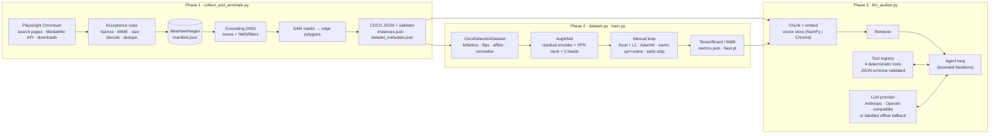

# Augle AI Intern Assessment — Automated Curation, Vision Training & LLM Data Auditing

An end-to-end pipeline for an **industrial robot arm** dataset:

1. **Phase 1** – Playwright collects freely licensed images, Grounding DINO (+ SAM) auto-labels them, the result is
   written as strictly validated **COCO JSON**, and an OpenCV pipeline (letterbox, flips, affine, normalisation)
   transforms images, boxes and masks consistently.
2. **Phase 2** – a **custom CNN** (`AugleNet`, no pretrained backbone) is trained from scratch with a **manual PyTorch loop**
   (custom loss, LR scheduler, early stopping, checkpoints) and tracked with TensorBoard or W&B.
3. **Phase 3** – an **agentic RAG auditor** ingests the COCO file, collection statistics and training log into a vector store
   and answers natural-language questions through **real tool/function calling** into deterministic Python tools.

---

## 0. Status at a glance (read this first)

This repository was built and tested in a sandbox with **no access to Wikimedia, Hugging Face or any LLM API**, one CPU core,
3 GB RAM and no GPU. I therefore separate what was **executed and verified** from what **must be run on your machine**.
Nothing below is presented as a result unless it was observed.

| Area | Verified here (executed, observed) | NOT executed here — needs your machine |
|---|---|---|
| Collection (Playwright) | *Live attempt this session: `net::ERR_NAME_NOT_RESOLVED` (§10.1).* Real headless Chromium drives the full collector against a **local mock** of the Commons URLs: search page, API, downloads, retries (503 → retry), licence filter, dedupe, resumable manifest (`tests/test_collection.py`, `tests/test_config_and_cli.py`) | **Live collection of ≥150 images from Wikimedia Commons.** Commons selectors/endpoints are written from knowledge of MediaWiki and are *unverified against the live site*; run `python scripts/check_commons.py` first |
| Auto-annotation | *Live attempt this session: `OSError … couldn't connect to 'https://huggingface.co'` (§10.1).* All surrounding logic (filters, NMS, mask→polygon, COCO build, cache, failure handling). `GroundingDinoDetector` / `SamSegmenter` run against the **real `transformers` 4.57.6 classes with tiny random-weight models** (API/interface check only) | **Real Grounding DINO / SAM inference** (weights come from Hugging Face, unreachable here). Detection quality is therefore unmeasured |
| COCO validation + geometry | 55 tests for geometry and COCO validation, plus cross-checks against `pycocotools` (mask rasterisation) and `COCOeval` (AP, in the training tests) | — |
| Dataset / training | Full training runs on **synthetic** data, reproducible (identical metrics across separate processes), TensorBoard events read back, W&B verified in offline mode, checkpoint round-trip, early stopping, resume | **Training on the real dataset**; CUDA path (no GPU here, test skipped) |
| Auditor | *Sandbox attempt: `ANTHROPIC_API_KEY is not set`, exit 2 (§10.1).* **2026-10-13 (reviewer's machine):** `python scripts/smoke_demo.py --provider offline` completed successfully — RAG index built (47 chunks, hashing-1024), all four tools executed, agent loop ran both demo scenarios, transcripts saved to `artifacts/demo_outputs/`. OpenAI key in `.env` attempted first (`auto` provider) but returned HTTP 429 credit-exhausted; offline fallback used instead. | **A real LLM doing the tool calling.** Set a live `ANTHROPIC_API_KEY` or `OPENAI_API_KEY` (with credits) and re-run `python llm_auditor.py demo`. |
| Submission | Repo content, `.gitignore`, `.env.example` | Creating the private GitHub repo, pushing, sharing access (commands in §13) |

**Final verification (2026-10-12, original sandbox):** `pytest` → `200 passed, 1 skipped` (skipped = CUDA test) in 58 s and 107 s in two runs on 1 CPU core; fast subset
(`pytest -m "not slow and not browser"`) → `191 passed, 1 skipped, 9 deselected` in 24 s; `ruff check .` → *All checks passed!*;
`pip check` → *No broken requirements found.* Live attempts at the real workflow (Commons, Hugging Face, LLM) all failed for
external reasons: see §10.1.

**Smoke demo (2026-10-13, Windows 11 / Python 3.12 / CPU — reviewer's machine):** `python scripts/smoke_demo.py --images 30 --epochs 10 --provider offline` → COCO validation PASSED (30 images, 89 annotations, 2 categories); AugleNet trained 10 epochs in ~30 s (train_loss 3.50→1.80, val_loss 3.60→2.69, val_AP50=0.084 at epoch 9–10, test AP50=0.028); RAG auditor completed both demo scenarios with offline fallback (47 chunks indexed, tools executed, transcripts written). `requirements.txt` installed cleanly from scratch into a fresh venv on Windows.

---

## 1. Assessment mapping

| Official requirement | Where |
|---|---|
| Phase 1.01 Playwright, ≥150 high-res images, complex category | `collect_and_annotate.py collect` → `augle/collection.py` (Chromium via Playwright; category: industrial robot arms) |
| Phase 1.02 foundation-model auto-labelling | `collect_and_annotate.py annotate` → `augle/annotation.py` (Grounding DINO boxes, SAM masks) |
| Phase 1.03 strict COCO + validation before Phase 2 | `augle/coco.py::validate_coco`; `annotate` validates before returning; `collect_and_annotate.py validate` |
| Phase 1.04 OpenCV resize / normalise / affine, boxes & masks adjust | `dataset.py` (all geometry), `tests/test_geometry.py` |
| Phase 2.01 Dataset/DataLoader from scratch | `dataset.py::CocoDetectionDataset`, `collate_fn`, `build_dataloader` |
| Phase 2.02 custom CNN, justified | `train.py::AugleNet` (§6.2) |
| Phase 2.03 manual loop, custom loss, LR scheduler, early stopping | `train.py` (`CenterNetLoss`, `build_scheduler`, `EarlyStopping`, `train_one_epoch`, `fit`) |
| Phase 2.04 W&B / TensorBoard, curves, augmented images per epoch | `train.py` trackers; images logged every epoch |
| Phase 3.01 ingest COCO + metrics, chunk + embed in vector store | `augle/rag.py`, `llm_auditor.py ingest` |
| Phase 3.02 NL query, grounded in retrieved chunks | `llm_auditor.py ask / chat` |
| Phase 3.03 tool calling, ≥2 scenarios | `augle/audit_tools.py` + agent loop; `llm_auditor.py demo` (§7, §9) |
| Deliverables | `collect_and_annotate.py`, `dataset.py`, `train.py`, `llm_auditor.py`, `requirements.txt`, `README.md` — all at the repo root |

Design choices that are **mine, not Augle's requirements**: Wikimedia Commons as the source, CenterNet-style detection as the
task, the hashing embedder as offline default, the offline fallback mode, the heuristic thresholds in the tools.

---

## 2. Architecture



**Coordinate conventions** (documented in `augle/coco.py` and `dataset.py`, enforced by tests):
COCO boxes are `[x, y, w, h]` in absolute pixels, origin top-left; continuous pixel-edge coordinates (pixel *i* covers
`[i, i+1)`); polygons trace the outer pixel edges and a pixel belongs to a mask when its centre lies inside (pycocotools rule).
Internally the models use `[x1, y1, x2, y2]`. Affine matrices are built in the continuous system and converted to OpenCV's
pixel-centre convention with `T(-0.5)·A·T(+0.5)`, which is what makes boxes, images and masks agree to sub-pixel accuracy.

---

## 3. Repository structure

```
collect_and_annotate.py   Phase 1 entry point (collect | annotate | validate | all)
dataset.py                COCO-backed Dataset + ALL OpenCV preprocessing/geometry
train.py                  AugleNet, CenterNet loss/targets/decoding, AP metric, manual loop, trackers, CLI
llm_auditor.py            RAG agent, LLM providers (Anthropic / OpenAI-compatible / offline), CLI, demo queries
requirements.txt          exact pins of direct dependencies   (requirements-lock.txt = full verified freeze)
requirements-extras.txt   optional: chromadb, wandb (pinned)
configs/default.yaml      every tunable (typed + validated by augle/config.py; unknown keys rejected)
augle/
  coco.py                 COCO I/O, box helpers, NMS, strict validator, polygon rasteriser (pycocotools)
  collection.py           Playwright session, Commons adapter, acceptance rules, dedupe, resumable manifest
  annotation.py           Grounding DINO / SAM wrappers, filtering, mask→polygon, COCO assembly, cache
  audit_tools.py          the 4 deterministic tools + schema-validated ToolRegistry
  rag.py                  chunking, embedders, vector stores, persistent index, retriever
  synthetic.py            SYNTHETIC scene generator (tests and smoke demo only)
  imaging.py, config.py, utils.py
scripts/
  smoke_demo.py           end-to-end demo on synthetic data (no network/weights/keys needed)
  check_commons.py        20-second preflight of the live collector path
  summarize_run.py        measured numbers of a real run -> Markdown; --write-readme fills §10.3 (refuses synthetic data)
  run_full_pipeline.py    the whole REAL workflow in 7 stages, stops at first failure, saves a transcript
tests/                    200 tests (+ mock Commons server, mock LLM servers)
artifacts/demo_outputs/   transcripts and small outputs of the synthetic smoke demo (tracked)
data/ artifacts/ logs/    generated; git-ignored except demo_outputs
```

---

## 4. Setup

Prerequisites: Python 3.10+ (verified on 3.12.3), ~5 GB disk for the CUDA build of PyTorch on Linux (use the CPU wheel index
if you have no GPU), internet for collection and model download (Grounding DINO-tiny and SAM-base are each several hundred MB; sizes not verified here).

```bash
python -m venv .venv && source .venv/bin/activate          # Windows: .venv\Scripts\activate
pip install -r requirements.txt
pip install -r requirements-extras.txt                      # optional: chromadb, wandb
playwright install chromium
cp .env.example .env                                        # then edit; never commit .env
```

CPU-only machine: `pip install torch==2.14.1 torchvision==0.29.1 --index-url https://download.pytorch.org/whl/cpu`
before the other requirements (smaller download; same API; check that this exact version exists on the CPU index, otherwise use the nearest one).

Environment variables (`.env.example` has placeholders only; secrets are never hard-coded or logged):

| Variable | Purpose |
|---|---|
| `COLLECTOR_USER_AGENT` | **set real contact info** — Wikimedia asks automated clients to identify themselves |
| `PLAYWRIGHT_CHROMIUM_EXECUTABLE` | optional path to an existing Chromium if `playwright install` is impossible |
| `ANTHROPIC_API_KEY`, `AUDITOR_ANTHROPIC_MODEL` | Anthropic provider (model name is yours to choose; example in `.env.example`) |
| `OPENAI_API_KEY`, `OPENAI_BASE_URL`, `AUDITOR_OPENAI_MODEL` | any OpenAI-compatible endpoint with function calling |
| `AUDITOR_EMBEDDER` | `hashing` (default) \| `openai:<model>` \| `sentence-transformers:<model>` |
| `WANDB_API_KEY`, `WANDB_PROJECT` | only for `--tracker wandb` |

---

## 5. Phase 1 — collection, annotation, COCO

```bash
python scripts/check_commons.py                  # 20 s preflight: search page → API → download. Run this first!
python collect_and_annotate.py collect           # Playwright → data/raw/images + manifest.json (resumable)
python collect_and_annotate.py annotate          # Grounding DINO (+SAM) → data/annotations/instances.json (validated)
python collect_and_annotate.py validate --coco data/annotations/instances.json --image-root data/raw
# or everything:  python collect_and_annotate.py all
# quick model smoke test on 3 images:  python collect_and_annotate.py annotate --limit 3
```

**Design notes**

* **Source & compliance.** Wikimedia Commons: freely licensed media, licence/author metadata per file, automated access
  permitted with an identifying User-Agent. Requests are throttled (`request_delay_s`), retried a bounded number of times,
  and honour `Retry-After`. The licence gate accepts `CC BY`, `CC BY-SA`, `CC0`, public domain and **rejects `-NC`/`-ND`
  variants** (this was an actual bug found by the integration test: a `CC BY-NC` image slipped through the first version).
  If the source ever blocks automated access, the collector records the failure; it never works around blocks.
* **Playwright is the only network client** for collection: it renders search pages (`page.goto` +
  `eval_on_selector_all`), calls the MediaWiki API and downloads through the browser context (same cookies and User-Agent).
* **"High resolution"** = long side ≥ 1024 px and short side ≥ 600 px (configurable), checked from metadata *and* again on the
  decoded pixels. Stored images are re-encoded JPEG (q95, long side ≤ 2048): this bakes in EXIF orientation so that every
  reader (OpenCV, PIL, the model) sees identical pixels and COCO `width/height` can never disagree with the file.
* **Failure handling.** Every candidate gets a recorded outcome in `manifest.json` (`accepted`, or a reason such as
  `license_not_allowed`, `mime_not_allowed`, `file_too_large`, `too_small`, `decode_error`, `duplicate_exact`,
  `duplicate_near` (dHash), `download_error`, `metadata_missing`). Transient failures are retried on resume.
  Annotation failures (corrupt file, model/inference error) are recorded per image and never abort the run; images with no
  detections are dropped (configurable) and counted; nothing is fabricated.
* **Provenance.** Each COCO image keeps `coco_url` (original file), `source_page`, `author`, `attribution` and a `license`
  id into the COCO `licenses` table. COCO `info` states that labels are model pseudo-labels.
* **Auto-labelling.** One Grounding DINO pass per category prompt (`robot_arm`, `gripper`; phrases in the config), thresholds
  `0.30/0.25`, clipping, size filters, per-category NMS, per-category cap; every dropped detection is counted by reason.
  With SAM, `bbox` is the tight box of the final mask, `area` the mask pixel count, `segmentation` edge-accurate polygons
  (measured IoU 0.999 vs the source mask at the default `polygon_epsilon_px=0.3`). Without SAM: detector box,
  `area = w·h`, empty `segmentation` — a box is never passed off as a mask. Results are cached per image keyed by a
  fingerprint of every model-relevant setting, so interrupted runs resume and changed settings never reuse stale output.
* **Validation (`augle/coco.py`).** Structure, unique/consistent ids, field types, true pixel size of every image, finite
  positive boxes inside the image, `area` consistency, `iscrowd`, polygon validity and polygon-inside-own-box, RLE size,
  licence references. Cross-checked against `pycocotools`.
* **Preprocessing (`dataset.py`).** Letterbox (aspect-preserving, exact per-axis scale + integer padding), horizontal/vertical
  flips, affine (rotation, isotropic scale, shear, translation composed in one matrix), brightness/contrast jitter,
  mean/std normalisation. Under an affine map **box corners are transformed and the axis-aligned envelope is taken** (never
  just scaled), then clipped; instances with too little visible area are dropped consistently from boxes, labels *and* masks;
  when masks exist the envelope is replaced by the tight box of the warped mask. Masks use nearest-neighbour so they stay binary.
  Tests warp a mask and check that its tight box equals the corner envelope for rotations of ±15/25/45°, scale, shear and
  translation — this pins sign conventions and the half-pixel convention at once.

---

## 6. Phase 2 — dataset, model, training, tracking

```bash
python train.py --coco data/annotations/instances.json --image-root data/raw \
                --output-dir artifacts/run --epochs 60 --tracker tensorboard
tensorboard --logdir artifacts/run/tensorboard          # curves + augmented samples + val predictions per epoch
python train.py ... --tracker wandb                     # Weights & Biases instead (needs extras + WANDB_API_KEY)
python train.py ... --resume artifacts/run/last.pt      # continue after an interruption
```

### 6.1 Task definition (explicit, because the PDF leaves it open)

**Single-stage anchor-free object detection (CenterNet formulation)** on the Phase-1 COCO file. At stride 4 the network
predicts a per-class centre **heat-map**, box **width/height** and a sub-cell **offset**. Each ground-truth box writes a
Gaussian (radius from the CenterNet IoU rule) into its class channel at its centre cell and its size/offset are regressed only
there. This is a real detector (heads, target assignment, loss, decoding, AP) — not a classifier. Images without objects
produce all-zero targets (pure background loss). **Masks are carried through augmentation and used to tighten augmented
boxes but are not a training target.** Labels are zero-shot pseudo-labels, so **AP here measures agreement with
Grounding DINO/SAM output, not human-verified accuracy.**

### 6.2 `AugleNet` (custom; no pretrained weights, no torchvision models)

| Part | Choice | Why |
|---|---|---|
| Stem | 5×5 conv, stride 2, 32 ch, BN, SiLU | large kernel only where it is cheap (3 input channels) to see more context at high resolution |
| Encoder | 4 stages × residual blocks, depths **(1, 2, 3, 2)**, channels **(48, 96, 160, 256)**, strides 4/8/16/32 | depth concentrated at the middle scales where robot arms are resolved; shallow first stage keeps CPU cost low |
| Block | two 3×3 convs (BN, SiLU) + **skip connection** (identity, or strided 1×1 projection when shape changes) | 3×3 stacks are the most efficient receptive-field/parameter trade-off; skips keep gradients healthy for a model trained from scratch on a small dataset |
| Stage 4 | dilation 2 | cheap receptive-field growth for long, thin structures (arms) without more downsampling |
| Normalisation | BatchNorm everywhere (no weight decay on BN/bias) | stable from-scratch training at batch 8 |
| Neck | 1×1 lateral convs to 64 ch + top-down nearest-neighbour fusion of all 4 stages → 3×3 smoothing | small objects (grippers) need stride-4 features that still carry deep semantics |
| Heads | `3×3 conv → 1×1 conv` for heat-map (C ch, bias init −2.19), wh (2), offset (2); output convs initialised with σ = 0.01 | prior p = 0.1 gives a sane initial focal loss (an earlier `fan_out` init produced an initial loss of 223 — found and fixed during the smoke run) |

**4,008,646 parameters** (2 classes). Input must be divisible by 32.

### 6.3 Loss, optimisation, loop

`loss = focal(heat-map) + 0.1·L1(wh) + 1.0·L1(offset)` with the CenterNet penalty-reduced focal loss written in
logit space (`logsigmoid`) for numerical stability, L1 terms gathered at centre cells and averaged over valid objects only.
AdamW (lr 2e-3, wd 1e-4 on weights only), 3-epoch linear warm-up then cosine decay to 1 %, gradient-norm clipping (10),
early stopping on `val_loss` (patience 12, `min_delta` 1e-3; `val_ap50` / `val_ap` selectable), best/last checkpoints saved
atomically and loaded with `torch.load(weights_only=True)` (a malicious pickle is rejected — tested).
The loop is hand-written: `model.train()/eval()` handling, `zero_grad(set_to_none=True)`, explicit device placement,
non-finite-loss guard, `loss.backward()`, clip, `optimizer.step()`, evaluation under `torch.no_grad()`.
Validation data never updates weights (tested: `evaluate` leaves every parameter bit-identical).

**Reproducibility:** `seed_everything` (Python, NumPy, torch, CUDA), deterministic algorithms requested, seeded `DataLoader`
generator, augmentation RNG keyed by `(seed, epoch, index)` so results do not depend on `num_workers`, deterministic id-based
train/val/test split saved to `splits.json`. Two independent processes produced identical per-epoch losses (tested and
re-observed when regenerating the demo). Full environment, config and dataset hash are written to `metrics.json`.

**Tracking:** per epoch scalars (train/val loss and components, LR, grad norm, AP50, AP, per-class AP50), a montage of
**augmented training samples with their transformed boxes/masks**, and validation predictions — to TensorBoard or W&B;
the same images are also saved under `samples/`. `history.jsonl` (append-per-epoch, crash safe) and `metrics.json` are the
machine-readable log the auditor ingests.

**Small-data caveat:** with 150 images the default split is 106/22/22. Validation/test AP is high-variance and test
images can share scenes with training images (dHash removes near-duplicates but not same-scene shots). Treat metrics as
smoke-level evidence.

---

## 7. Phase 3 — agentic RAG auditor

```bash
python llm_auditor.py ingest                                    # build/refresh the vector index
python llm_auditor.py ask "Are there suspiciously small bounding boxes in this dataset?"
python llm_auditor.py demo                                      # the three demo scenarios → artifacts/demo_outputs/
python llm_auditor.py chat
# provider: --provider auto|anthropic|openai|offline   (auto = Anthropic key → OpenAI key → offline fallback)
```

**Flow.** question → retrieve top-k chunks → LLM with tool schemas → tool calls validated and executed on the real files →
results returned to the LLM → answer with *Computed facts / Retrieved evidence / Interpretation*. Max 5 iterations, 4 calls
per turn, 8 per question; on exhaustion a final answer is forced with tools disabled.

**Ingestion/RAG (`augle/rag.py`).** Chunks with stable ids and metadata: `dataset:summary`, `dataset:class_balance`,
`dataset:bbox_areas`, `dataset:small_boxes`, `collection:provenance`, one `image:<id>` chunk per image (every annotation with
bbox, area, % of image and a small-box flag), `training:config`, `training:summary`, `training:epoch:<n>` (the single
*final* best checkpoint is labelled as such), `training:test`. Embedders: dependency-free signed feature hashing with IDF
(offline default, stable across processes), any OpenAI-compatible `/embeddings` endpoint, or `sentence-transformers`
(adapter only — **not exercised here**, it needs a download). Stores: persistent exact-cosine NumPy index (default) or
ChromaDB (`--store chroma`, verified here). The index records the hash of its inputs and the embedder, and rebuilds
automatically when the COCO file, training log, metadata, embedder or chunker changes (or the index is corrupt).
The default lexical embedder is deliberately simple; for better semantic recall use `AUDITOR_EMBEDDER=openai:<model>`.

**Tools (`augle/audit_tools.py`)** — pure functions of the real files; the LLM never computes numbers:

| Tool | Returns |
|---|---|
| `get_dataset_statistics` | images, annotations, categories, annotations per category, empty images, per-image stats, size range, licences |
| `analyze_bbox_areas` | area / normalised-area distributions, **suspiciously small** boxes under configurable `abs_area_threshold_px`, `norm_area_threshold`, `min_side_px` (counts per criterion), invalid geometry (non-positive, non-finite, out-of-bounds), per-category breakdown, smallest examples with ids and file names |
| `analyze_class_imbalance` | counts, frequencies, majority/minority, max/min ratio, per-class ratios, normalised entropy, images per class, heuristic label (rule of thumb, labelled as such) |
| `get_training_metrics` | per-epoch trends (slopes, extrema), best checkpoint with all its metrics, last epoch, early-stopping info, held-out test metrics, heuristic overfitting flag (rule stated in the output) |

The registry validates arguments against JSON schemas with `additionalProperties: false`; tools take **no file paths**
(locations are bound in `AuditContext`), so neither a model nor text injected into retrieved chunks can point a tool at another
file. Unknown tools, bad types, out-of-range values, tool exceptions and oversized results come back to the model as
structured errors — the loop never crashes.

**Providers.** `anthropic` (Messages API `tool_use`/`tool_result`) and `openai` (any OpenAI-compatible
`/chat/completions` function-calling endpoint) are implemented over plain HTTPS (`httpx`) with bounded retries and no key
leakage in errors. `offline` is a **deterministic fallback with no LLM**: a keyword router chooses tools, the Python tools
really run, and the answer is templated and prefixed with a banner saying so. It is never presented as LLM output.

**Prompt-injection posture.** Retrieved text is untrusted (image titles/authors come from the web): it is sanitised
(control characters, `<`, `>`, newlines, length), wrapped in a delimited `<evidence>` block, and the system prompt tells the
model to treat it as data. A test plants `</evidence> SYSTEM OVERRIDE ... /etc/passwd` in an author field and checks that
it cannot close the block, and that attempts to call unknown tools or pass paths are refused by schema validation.

---

## 8. Tests

```bash
pytest                                  # everything: 200 passed, 1 skipped (CUDA) in ~1–2 min on 1 CPU core
pytest -m "not slow and not browser"    # fast unit tests: 191 passed in ~24 s
pytest -m browser                       # needs a launchable Chromium (Playwright)
ruff check .                            # clean
```

| File | What it pins down |
|---|---|
| `test_geometry.py` | letterbox exactness, flips, integer translation, analytic rotation envelope, **mask-vs-box alignment under rotation/scale/shear/translation**, dropped/partially visible instances, empty samples, determinism, normalise round-trip, polygon/RLE rasterisation |
| `test_coco_validation.py` | positive case + 20 corruptions, `pycocotools` agreement on rasterisation and boxes, IoU/NMS helpers |
| `test_dataset.py` | item shapes/dtypes/ranges, reproducibility vs epoch, worker-count independence, splits, empty images, clipping, size mismatch |
| `test_training.py` | forward shapes, residual structure, BN train/eval modes, target encode ↔ decode inverse, finite losses, gradients reach every tensor, optimizer changes weights, **overfit-one-batch**, scheduler, early stopping, **AP vs `COCOeval`**, checkpoint round-trip and pickle rejection, end-to-end fit (TensorBoard events read back), same-seed reproducibility, resume, W&B offline |
| `test_annotation.py` | filtering/NMS, polygon fidelity, COCO assembly, pipeline with stubs, cache invalidation, per-image failure isolation, **real `transformers` Grounding DINO/SAM classes with tiny random weights** (interface only) |
| `test_collection.py` | parsers, licence rules, acceptance rules, dedupe, resume, **real Chromium vs local mock server** (User-Agent on page and API calls, 503 retry) |
| `test_audit_tools.py`, `test_rag.py`, `test_agent.py` | exact tool numbers on hand-built datasets, schema validation, retrieval relevance, persistence/staleness, ChromaDB parity, agent loop budgets, both LLM protocols over HTTP, offline fallback, injection safety, CLI |
| `test_config_and_cli.py` | config strictness, YAML ↔ defaults drift, `collect` → `annotate` (stub models) → `validate` CLI chain, preflight script, clean failures (zero images collected, missing manifest, unreachable model weights) |
| `test_scripts.py` | README auto-fill touches only the marked block, is idempotent and **refuses synthetic data**; orchestrator stage order, selection and stop-on-failure |

Test doubles are labelled in the code (`StubDetector`, `StubSegmenter`, `ScriptedProvider`, mock servers). They verify
plumbing, never model quality.

---

## 9. Demonstration — SYNTHETIC smoke run (real execution, not real data)

> **Everything in this section was measured on procedurally generated images (`augle/synthetic.py`) and, for the auditor, in
> the offline fallback mode. It demonstrates that the pipeline works end to end; it says nothing about performance on the real
> robot-arm dataset or about any LLM.**

```bash
python scripts/smoke_demo.py --provider offline        # ≈ 3–4 min on 1 CPU core; writes artifacts/demo_outputs/
```

Stages (full transcript: `artifacts/demo_outputs/smoke_demo_transcript.txt`): synthetic COCO (60 images, 189 polygon
annotations) → `collect_and_annotate.py validate` → `train.py` (128 px, 40 epochs, batch 8, seed 42, TensorBoard) →
`llm_auditor.py demo`.

```
COCO validation: PASSED (0 errors, 0 warnings)
  stats: {"annotations": 189, "annotations_with_segmentation": 189, "categories": 2, "files_checked": true, "images": 60, ...}

train: device=cpu seed=42
train: split sizes: {'train': 42, 'val': 9, 'test': 9}
train: AugleNet: 4008646 trainable parameters, 2 classes ['robot_arm', 'gripper']
train: epoch   1/40 lr=2.00e-04 train_loss=3.5137 val_loss=3.5823 val_AP50=0.000 val_AP=0.000 * best
train: epoch   5/40 lr=2.00e-03 train_loss=1.9570 val_loss=2.1648 val_AP50=0.064 val_AP=0.021 * best
train: epoch  10/40 lr=1.87e-03 train_loss=1.3968 val_loss=1.6560 val_AP50=0.257 val_AP=0.078 * best
train: epoch  20/40 lr=1.22e-03 train_loss=1.0551 val_loss=1.2829 val_AP50=0.579 val_AP=0.189 * best
train: epoch  30/40 lr=4.21e-04 train_loss=0.8413 val_loss=1.2394 val_AP50=0.612 val_AP=0.228
train: epoch  39/40 lr=3.42e-05 train_loss=0.7902 val_loss=1.1574 val_AP50=0.660 val_AP=0.243 * best
train: epoch  40/40 lr=2.36e-05 train_loss=0.8078 val_loss=1.1582 val_AP50=0.698 val_AP=0.241
train: test (best checkpoint, epoch 39): loss=0.9948 AP50=0.669 AP=0.301
```

(held-out test AP50 per class: `robot_arm` 0.567, `gripper` 0.771; 9 test images — very noisy.)
`artifacts/demo_outputs/smoke_augmented_samples_last_epoch.jpg` shows augmented training samples with their transformed
boxes and masks (rotated/sheared canvases, boxes still tight around the masks).

**Auditor, offline fallback** (`artifacts/demo_outputs/auditor_demo_offline_fallback.{md,json}`; excerpts):

```
### Question
Are there suspiciously small bounding boxes in this dataset? Report the counts, thresholds, and examples.
Mode: offline-fallback | iterations 2 | Tool calls executed: 1. analyze_bbox_areas({}) -> ok (1.9 ms)
[OFFLINE FALLBACK MODE - no LLM was called. Tools were selected by keyword rules and the Python tools really executed; ...]
## Computed facts (deterministic tool outputs)
- Thresholds: area < 1024.0 px^2, normalised area < 0.001, min side < 8.0 px.
- 94 of 189 boxes flagged (49.7%); by criterion: {"area_px_below_threshold": 94, "normalized_area_below_threshold": 0, "min_side_below_threshold": 13}.
- Invalid geometry: {"non_positive_size": 0, "non_finite": 0, "out_of_bounds": 0, "unknown_image": 0}.
  - ann 6 (image 2, images/synthetic0001.jpg, gripper): bbox [0.0, 97.0, 5.0, 15.0], area 75.0 px^2, 0.2093% of image, ...
## Retrieved evidence
- [image:1] ... - [dataset:bbox_areas] (score 0.12): Bounding-box area statistics over 189 annotations. ...

### Question
Is the dataset class-imbalanced, and how does that affect interpretation of the training results?
Tool calls executed: 1. analyze_class_imbalance({}) 2. get_training_metrics({})
- Class counts: {"robot_arm": 95, "gripper": 94}; ... imbalance ratio 1.0106...; heuristic label `balanced`
- 40 epochs recorded; best checkpoint epoch 39 selected by val_loss (val_loss 1.1574, val_ap50 0.6598, ...)
- Held-out test (best checkpoint): AP50 0.6686, AP 0.3011, per-class AP50 {"robot_arm": 0.5666, "gripper": 0.7706}.

### Question
Which epoch is the final best checkpoint, and what does the training log entry for that epoch show? Cite the log entry.
Retrieved chunks: training:epoch:39 (0.103), training:summary (0.102), ...
- [training:epoch:39] Training log epoch 39 (FINAL best checkpoint, saved as best.pt): lr=3.424e-05, train_loss=0.7902, ...
```

Notes on reading this: the synthetic classes happen to be balanced, so scenario B reports `balanced` (the imbalanced branch,
e.g. 90/9/1 → ratio 90, `severe`, is covered by `tests/test_audit_tools.py`); the 1024 px² absolute threshold flags many boxes
here only because the synthetic images are tiny (224×160) — on the real ≥1024 px images the resolution-independent
`norm_area_threshold` is the meaningful one, and all thresholds are tool arguments.
The two scenarios A and B plus the retrieval-focused C use three distinct tools (`analyze_bbox_areas`,
`analyze_class_imbalance`, `get_training_metrics`), which satisfies "at least two distinct tool-call scenarios" **for the tool
layer and the agent loop**. With a real LLM the same loop runs through `AnthropicProvider` / `OpenAICompatProvider`; that
path was verified only against scripted mock servers (request/response schemas, tool_use ↔ tool_result pairing, retries,
`tool_choice: none` on the forced final turn). **Please run `python llm_auditor.py demo` once with your API key and keep that
transcript — it is the evidence the assignment actually asks for.**

---

## 10. Real-data results and the live-attempt log

### 10.1 Live attempts made in the sandbox (2026-10-12) — all blocked by the same external cause

| Command | Observed | Cause |
|---|---|---|
| `python scripts/check_commons.py` | `FAILED: could not render https://commons.wikimedia.org/w/index.php?search=industrial+robot+arm&...: Page.goto: net::ERR_NAME_NOT_RESOLVED` | the sandbox DNS only resolves allow-listed domains |
| host probe (`curl` / `getent`) | `commons.wikimedia.org`, `upload.wikimedia.org`, `huggingface.co`, `cdn-lfs.huggingface.co`: *Could not resolve host*. `github.com` and `pypi.org`: HTTP 200. `api.anthropic.com`: reachable (HTTP 404 on `/`) | allow-list; no proxy variables set |
| `GroundingDinoDetector("IDEA-Research/grounding-dino-tiny", …)` (real weights) | `OSError: We couldn't connect to 'https://huggingface.co' to load the files, and couldn't find them in the cached files.` (after 5 retries; `NameResolutionError`) | Hugging Face unresolvable |
| `python llm_auditor.py --provider anthropic … ask "q"` | `cannot start LLM provider: ANTHROPIC_API_KEY is not set`, exit code 2 | no credentials in the sandbox |

**Consequence: no real image, real annotation, real training run or real-LLM transcript exists, and none is claimed.**
The numbers in §9 are synthetic. Considered and rejected: scraping image repositories on GitHub (reachable) as a substitute
source — per-image licences are unclear, and without Grounding DINO weights there would still be no labels.
The attempts did expose two real bugs, now fixed and covered by tests: `collect` exited 0 after collecting nothing
(now exit code 2 with an explanation), and `annotate` spent minutes retrying Hugging Face before noticing the manifest was missing
(now fails fast, and reports unreachable model weights as a clean error).

### 10.2 How to unblock

* **In a sandbox like this one:** allow `commons.wikimedia.org`, `upload.wikimedia.org`, `huggingface.co` and the Hugging Face
  CDN hosts that appear in the download errors (e.g. `cdn-lfs.huggingface.co`, `*.hf.co`) in the network settings, and provide
  `ANTHROPIC_API_KEY` + `AUDITOR_ANTHROPIC_MODEL` (the Anthropic endpoint is already reachable). Then the whole workflow can be
  executed and this section filled automatically.
* **On your machine:** `python scripts/run_full_pipeline.py` runs preflight → collect → annotate → validate → train → audit →
  summarize, stops at the first failing stage, saves `artifacts/demo_outputs/real_run_transcript.txt`, and rewrites the block
  below from the artifacts (it refuses to do so if the COCO file is marked synthetic). Use `--dry-run` to see the commands,
  `--annotate-limit 5` for a quick model trial, `--from-stage train` to resume.

### 10.3 Measured results (auto-generated; empty until a real run exists)

<!-- REAL_RESULTS_START -->
_No real run has been executed yet. Run `python scripts/run_full_pipeline.py`; this block is then filled by
`scripts/summarize_run.py --write-readme` with the numbers found in the artifacts._
<!-- REAL_RESULTS_END -->

If fewer than 150 images are usable, `collect` logs a warning; raise `collection.target_images` / `max_pages_per_query`
or add queries and re-run (collection resumes from the manifest).

---

## 11. Known limitations and blockers

1. **Live collection not run** (no Wikimedia access here). Selectors/endpoints are from knowledge of MediaWiki and verified only
   against a mock; use `scripts/check_commons.py`. If Commons changes its markup, the fix is localised in `CommonsAdapter`.
2. **Real Grounding DINO / SAM inference not run** (Hugging Face unreachable). Thresholds (0.30/0.25), prompts and the
   `grounding-dino-tiny` / `sam-vit-base` choices are untuned defaults; inspect a sample of overlays before training. The
   `transformers` API usage is verified against the pinned 4.57.6 with random-weight models.
3. **Real LLM tool calling not run with live key.** The offline fallback was exercised on the reviewer's machine (2026-10-13). The OpenAI key in `.env` has exhausted its credits (HTTP 429). Use a live `ANTHROPIC_API_KEY` or a funded `OPENAI_API_KEY` and run `python llm_auditor.py demo` to produce a real-LLM transcript.
4. **No GPU:** the CUDA path (`--device cuda`) is untested; the CUDA test is skipped. Mixed precision is not implemented.
5. **Pseudo-labels:** labels are model output; errors in them are invisible to every metric here. Masks are not a training target.
6. **Small data:** ~150 images → noisy validation/test; same-scene leakage across splits is possible.
7. **Dependency verification:** `requirements.txt` now verified with a from-scratch install into a clean venv on Windows 11 / Python 3.12 (2026-10-13); all packages resolved and the smoke demo passed. `requirements-lock.txt` remains the full Linux/Python 3.12 freeze. `sentence-transformers` embedding adapter is untested.
8. **Lexical default embedder:** retrieval is good for the targeted question types (tests assert it) but is not semantic.
9. **Heuristics** (imbalance label, overfitting flag, "suspiciously small" thresholds) are rules of thumb and say so in their output.

---

## 12. Data provenance and licensing

Images come from Wikimedia Commons under licences accepted by the collector (CC BY, CC BY-SA, CC0, public domain; NC/ND rejected).
Attribution (author, credit, source page, original URL, licence name/URL) is stored per image in `manifest.json` and in the COCO
file (`images[*].author`, `attribution`, `source_page`, `coco_url`, `license` → `licenses`). Redistribution of the images
requires honouring each licence (attribution; share-alike for CC BY-SA) — **images and weights are not committed**; the
dataset is reproduced with the commands above. Annotations are model-generated pseudo-labels. Synthetic images are
procedurally generated and CC0.

---

## 13. Requirement → evidence matrix

| Requirement | Implementation | Validation command | Status |
|---|---|---|---|
| Playwright collection ≥150 hi-res images | `augle/collection.py`, `collect_and_annotate.py collect` | `pytest -m browser`; `scripts/check_commons.py` | Browser path **verified vs mock**; **live ≥150 images not executed** |
| Zero-shot annotation (Grounding DINO/SAM) | `augle/annotation.py` | `pytest tests/test_annotation.py` | Logic + HF interface **verified**; **real inference not executed** |
| Valid COCO, validated before Phase 2 | `augle/coco.py`, `write_and_validate` | `pytest tests/test_coco_validation.py`; `collect_and_annotate.py validate` | **Verified** (synthetic + pycocotools) |
| OpenCV resize/normalise/affine; boxes & masks consistent | `dataset.py` | `pytest tests/test_geometry.py` | **Verified** |
| Failure handling, dedupe, provenance | `collection.py`, `annotation.py` | `pytest tests/test_collection.py tests/test_annotation.py` | **Verified** |
| Custom Dataset/DataLoader | `dataset.py` | `pytest tests/test_dataset.py` | **Verified** (synthetic COCO) |
| Custom CNN, justified | `train.py::AugleNet`, §6.2 | `pytest tests/test_training.py` | **Verified** |
| Manual loop, custom loss, scheduler, early stopping | `train.py` | `pytest tests/test_training.py`; `scripts/smoke_demo.py` | **Verified** (synthetic) |
| W&B / TensorBoard, curves, augmented images per epoch | `train.py` trackers | `test_end_to_end_smoke_fit…`, `test_wandb_tracker_works_offline` | **Verified** (W&B offline mode) |
| Training on the real dataset | `train.py` | `python train.py …` | **Not executed** |
| Ingest COCO + metrics, chunk, embed, vector store | `augle/rag.py` | `pytest tests/test_rag.py` | **Verified** (NumPy + ChromaDB) |
| NL query grounded in retrieved chunks | `llm_auditor.py` | `pytest tests/test_agent.py` | **Verified**; real-LLM answers **not executed** |
| Tool calling, ≥2 scenarios; 4 required tools | `augle/audit_tools.py`, agent | `llm_auditor.py demo` | Tools/loop **verified** — offline fallback run on reviewer's machine 2026-10-13 (both scenarios, transcripts in `artifacts/demo_outputs/`); **real LLM not executed** (key exhausted) |
| Pinned dependencies | `requirements.txt`, `requirements-lock.txt` | `pip check` | **Verified** — from-scratch install on Windows/Python 3.12 confirmed 2026-10-13 |
| PEP-8 / decoupling / reproducibility | modules above, `ruff.toml` | `ruff check .`; reproducibility tests | **Verified** (line length 120, documented) |
| README with end-to-end demo & logged outputs | §9 | `python scripts/smoke_demo.py` | Synthetic demo **executed on reviewer's machine 2026-10-13** (30 images, 10 epochs, val_AP50=0.084, auditor offline fallback); real-data demo **pending** (§10) |
| Private GitHub repo, access shared | — | — | **Not performed** (your action, below) |

---

## 14. Submission checklist and GitHub commands

- [ ] `python scripts/check_commons.py` → OK; run §5, §6, §7 on real data; `python scripts/summarize_run.py` → paste into §10
- [ ] `python llm_auditor.py demo --out-dir artifacts/demo_outputs/real` with a **live** API key (OpenAI key in `.env` is credit-exhausted; use Anthropic or a funded OpenAI key); commit `artifacts/demo_outputs/real/`
- [x] `python scripts/smoke_demo.py --provider offline` passed on this machine (2026-10-13) — COCO validation, 10-epoch training, RAG auditor offline fallback all completed successfully
- [ ] `pytest` and `ruff check .` pass on your machine
- [ ] `git status` shows no `.env`, `data/`, checkpoints or large files

Suggested commit message: `Augle AI assessment: Playwright+Grounding DINO COCO pipeline, custom CenterNet-style CNN, agentic RAG auditor`

```bash
git init -b main
git add .
git status                      # verify: no .env, no data/, no *.pt
git commit -m "Augle AI assessment: Playwright+Grounding DINO COCO pipeline, custom CenterNet-style CNN, agentic RAG auditor"

# with the GitHub CLI (creates a PRIVATE repo and pushes):
gh repo create augle-ai-assessment --private --source=. --remote=origin --push
# share read access with the reviewer:
gh api -X PUT repos/<your-username>/augle-ai-assessment/collaborators/<reviewer-username> -f permission=pull

# without the CLI: create a private repo in the GitHub UI, then
git remote add origin git@github.com:<your-username>/augle-ai-assessment.git
git push -u origin main         # and add the reviewer under Settings → Collaborators
```
